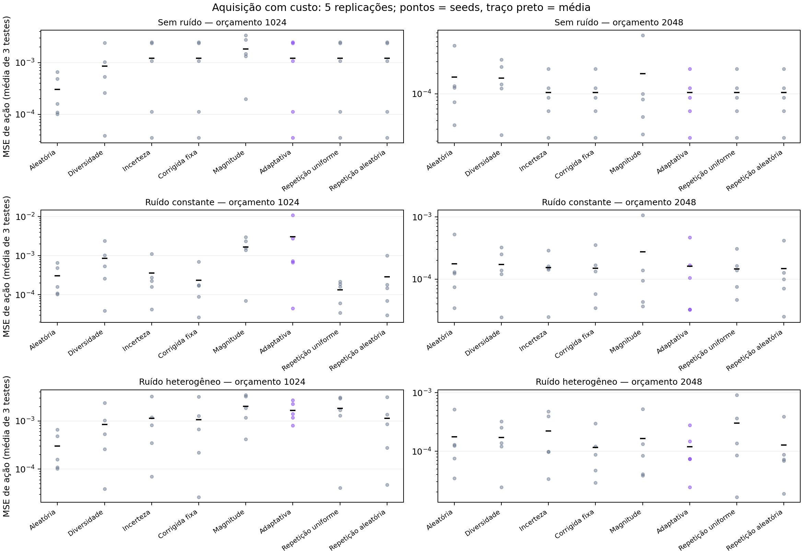

# Aquisição contrafactual — resultados v1

**Gate definido antes da rodada: NÃO PASSOU.**

Este é um piloto controlado com CNN pequena e ruído sintético. Os resultados não estabelecem novidade, segurança ou eficiência em uma VLA real.

## Execução e validade

Executados 180 treinos de adaptação principais e 60 controles adicionais, além de 15 pré-treinos e 5 continuações sem novos rótulos. Conferidos 240 ledgers: nenhuma duplicação de referência, estouro de orçamento ou divergência entre trace e custo.

Cinco replicações mudam dados, inicialização e bootstrap. Os seletores recebem respostas/representações, sem acesso a rótulos de referência. As referências são consultadas somente para os exemplos adquiridos no treino. O orçamento mede créditos marginais simulados: não é tempo humano nem chamadas ao Alpamayo.

MSE primário médio antes de adaptar: 0.00989121; após continuar sem referências novas: 0.00782846. Os testes são independentes do treino, pool e validação; a validação factual seleciona checkpoints.

Aleatória e diversidade são independentes do regime de ruído: suas repetições entre regimes não são novas evidências independentes. A métrica primária dá peso igual a ID, severidade e fundo invertido, conforme definido antes dos resultados.

## Resultado primário

Média das cinco replicações; menor MSE é melhor. Rótulos são quartetos completos, não exemplos individuais.

| Ruído | Créditos | Método | MSE primário | Quartetos | Sondas de resposta |
|---|---:|---|---:|---:|---:|
| Sem ruído | 1024 | Aleatória | 0.00030366 | 32.0 | 0.0 |
| Sem ruído | 1024 | Diversidade | 0.00084974 | 29.0 | 0.0 |
| Sem ruído | 1024 | Incerteza | 0.00121166 | 14.0 | 576.0 |
| Sem ruído | 1024 | Corrigida fixa | 0.00121166 | 14.0 | 576.0 |
| Sem ruído | 1024 | Magnitude | 0.00182221 | 14.0 | 576.0 |
| Sem ruído | 1024 | Adaptativa | 0.00121166 | 14.0 | 576.0 |
| Sem ruído | 1024 | Repetição uniforme | 0.00121166 | 14.0 | 576.0 |
| Sem ruído | 1024 | Repetição aleatória | 0.00121166 | 14.0 | 576.0 |
| Sem ruído | 2048 | Aleatória | 0.00017704 | 64.0 | 0.0 |
| Sem ruído | 2048 | Diversidade | 0.00017186 | 61.0 | 0.0 |
| Sem ruído | 2048 | Incerteza | 0.00010493 | 46.0 | 576.0 |
| Sem ruído | 2048 | Corrigida fixa | 0.00010493 | 46.0 | 576.0 |
| Sem ruído | 2048 | Magnitude | 0.00019822 | 46.0 | 576.0 |
| Sem ruído | 2048 | Adaptativa | 0.00010493 | 46.0 | 576.0 |
| Sem ruído | 2048 | Repetição uniforme | 0.00010493 | 46.0 | 576.0 |
| Sem ruído | 2048 | Repetição aleatória | 0.00010493 | 46.0 | 576.0 |
| Ruído constante | 1024 | Aleatória | 0.00030366 | 32.0 | 0.0 |
| Ruído constante | 1024 | Diversidade | 0.00084974 | 29.0 | 0.0 |
| Ruído constante | 1024 | Incerteza | 0.00036174 | 14.0 | 576.0 |
| Ruído constante | 1024 | Corrigida fixa | 0.00023335 | 14.0 | 576.0 |
| Ruído constante | 1024 | Magnitude | 0.00167709 | 14.0 | 576.0 |
| Ruído constante | 1024 | Adaptativa | 0.00303204 | 10.0 | 688.0 |
| Ruído constante | 1024 | Repetição uniforme | 0.00013283 | 10.0 | 688.0 |
| Ruído constante | 1024 | Repetição aleatória | 0.00028604 | 10.0 | 688.0 |
| Ruído constante | 2048 | Aleatória | 0.00017704 | 64.0 | 0.0 |
| Ruído constante | 2048 | Diversidade | 0.00017186 | 61.0 | 0.0 |
| Ruído constante | 2048 | Incerteza | 0.00015336 | 46.0 | 576.0 |
| Ruído constante | 2048 | Corrigida fixa | 0.00014943 | 46.0 | 576.0 |
| Ruído constante | 2048 | Magnitude | 0.00027671 | 46.0 | 576.0 |
| Ruído constante | 2048 | Adaptativa | 0.00016102 | 34.0 | 944.0 |
| Ruído constante | 2048 | Repetição uniforme | 0.00014672 | 34.0 | 944.0 |
| Ruído constante | 2048 | Repetição aleatória | 0.00014770 | 34.0 | 944.0 |
| Ruído heterogêneo | 1024 | Aleatória | 0.00030366 | 32.0 | 0.0 |
| Ruído heterogêneo | 1024 | Diversidade | 0.00084974 | 29.0 | 0.0 |
| Ruído heterogêneo | 1024 | Incerteza | 0.00113744 | 14.0 | 576.0 |
| Ruído heterogêneo | 1024 | Corrigida fixa | 0.00107119 | 14.0 | 576.0 |
| Ruído heterogêneo | 1024 | Magnitude | 0.00203214 | 14.0 | 576.0 |
| Ruído heterogêneo | 1024 | Adaptativa | 0.00166600 | 10.0 | 688.0 |
| Ruído heterogêneo | 1024 | Repetição uniforme | 0.00181389 | 10.0 | 688.0 |
| Ruído heterogêneo | 1024 | Repetição aleatória | 0.00114172 | 10.0 | 688.0 |
| Ruído heterogêneo | 2048 | Aleatória | 0.00017704 | 64.0 | 0.0 |
| Ruído heterogêneo | 2048 | Diversidade | 0.00017186 | 61.0 | 0.0 |
| Ruído heterogêneo | 2048 | Incerteza | 0.00022134 | 46.0 | 576.0 |
| Ruído heterogêneo | 2048 | Corrigida fixa | 0.00011664 | 46.0 | 576.0 |
| Ruído heterogêneo | 2048 | Magnitude | 0.00016404 | 46.0 | 576.0 |
| Ruído heterogêneo | 2048 | Adaptativa | 0.00011964 | 34.0 | 944.0 |
| Ruído heterogêneo | 2048 | Repetição uniforme | 0.00030435 | 34.0 | 944.0 |
| Ruído heterogêneo | 2048 | Repetição aleatória | 0.00012725 | 34.0 | 944.0 |

## Gate e comparações pareadas

Gate: no ruído heterogêneo, vencer aleatória e corrigida fixa nas cinco seeds e obter redução média de pelo menos 5% contra ambas em algum orçamento. Não mudamos essa regra depois dos resultados.

| Créditos | Comparação da adaptativa com | Vitórias / 5 | Redução do MSE médio |
|---|---|---:|---:|
| 1024 | Aleatória | 0/5 | -448.6% |
| 1024 | Diversidade | 0/5 | -96.1% |
| 1024 | Incerteza | 1/5 | -46.5% |
| 1024 | Corrigida fixa | 1/5 | -55.5% |
| 1024 | Magnitude | 3/5 | +18.0% |
| 1024 | Repetição uniforme | 3/5 | +8.2% |
| 1024 | Repetição aleatória | 1/5 | -45.9% |
| 2048 | Aleatória | 4/5 | +32.4% |
| 2048 | Diversidade | 5/5 | +30.4% |
| 2048 | Incerteza | 4/5 | +45.9% |
| 2048 | Corrigida fixa | 3/5 | -2.6% |
| 2048 | Magnitude | 3/5 | +27.1% |
| 2048 | Repetição uniforme | 3/5 | +60.7% |
| 2048 | Repetição aleatória | 1/5 | +6.0% |

Os intervalos no JSON são bootstrap das cinco diferenças pareadas e são exploratórios. Não tratamos 256 cenas de teste como 256 retreinos independentes. Cinco replicações ainda fornecem pouca precisão para inferência.

## Controles adicionados durante a rodada

Depois de inspecionar a primeira seed, adicionamos repetições uniformes e aleatórias com o mesmo número exato de consultas extras e de referências da regra adaptativa. Esse adendo está documentado; não o apresentamos como comparação confirmatória pré-registrada. Ele verifica se a alocação adaptativa acrescenta algo a simplesmente repetir mais.

## Interpretação e limites

A regra adaptativa v1 não justificou o próximo investimento pelo gate definido. A primeira réplica favorável em alguns casos não se converteu em vantagem consistente. Preservamos os resultados negativos e não ampliamos para fine-tuning de VLA real com base neles.

O experimento testa uma heurística específica: desacordo de efeitos entre membros, correção de variância e repetições orientadas por imprecisão. Ele não testa todas as formas de aquisição ativa. Desacordo ou magnitude da resposta não são, por si só, estimativas do ganho de treinamento de um rótulo.

Há uma única razão de custo assumida (32 créditos por referência) e um ambiente de decisão de um passo. O ruído é gaussiano aditivo, os modelos de aquisição ficam congelados e os exemplos são adquiridos em batch. A largura de imprecisão não tem garantia de cobertura e a correção de variância não tem garantia automática sob parada adaptativa.

Não usamos estes testes para escolher outro método ou threshold e rebatizar o mesmo resultado como confirmação. Qualquer variante posterior precisa de protocolo próprio e novos dados de confirmação.

## Reprodução

- Principal: `artifacts/acquisition_v1_20261020`; configuração e código exato em `manifest.json` e `source_snapshot/`.
- Controles: `artifacts/acquisition_controls_v1_20261020`; o ensemble é reutilizado após conferir hashes dos datasets.
- `summary.csv`: inclui também ID, severidade e fundo individualmente.
- `runs.json`: métricas por seed, custos e tempos de treino.
- `seed*/`: histórico de consultas, exemplos adquiridos, curvas, checkpoints e previsões.
