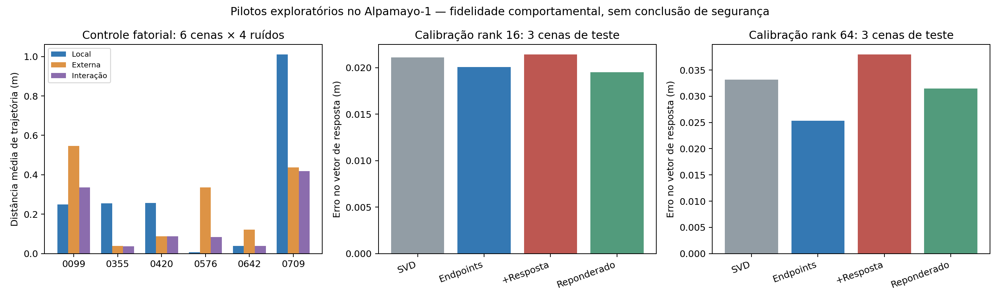

# Rodada real: candidatos, controles e decisão

20/10/2026. **Ainda não existe candidato validado que possamos defender como
contribuição de ICML.** Esta rodada saiu dos toys e executou o Alpamayo-1 real
com imagens locais de 21 cenas. A hipótese mais fundamentada agora é aprender
efeitos confiáveis sob intervenções visuais imperfeitas; os dados sustentam o
problema, ainda não um novo método que o resolva.

## O que foi executado

- Intervenções no cache em 3 cenas iniciais e outras 12, quatro ruídos do decoder.
- Captura reproduzível de caches em seis outras cenas, separando 3 de treino e 3
  de teste antes da aprendizagem. Checkpoints e referências ficaram locais.
- Seis calibrações aprendidas: três objetivos nos ranks 16 e 64, 36 updates cada.
  SVD sem calibração foi avaliado nos dois ranks. Oito ruídos novos no teste.
- Controle de serialização: 12 replays original/editado coincidiram exatamente
  com as trajetórias geradas pela implementação externa. Em rank 128, a
  fatorização/reconstrução bf16 ainda introduz pequeno erro numérico.
- Auditoria descritiva de duas versões arquivadas em 2.465 pares de 166 cenas.
- Experimento fatorial novo em seis cenas: quatro condições de imagem, quatro
  ruídos do decoder, mais repetição idêntica da original na primeira cena.

A seed de linguagem é 123 por imagem. Fixamos a seed do decoder **depois** da
geração de linguagem, garantindo o mesmo ruído inicial mesmo quando o texto
tem comprimentos diferentes. Não confundimos quatro ruídos de trajetória com
quatro cenas ou quatro gerações independentes de raciocínio.

As 21 cenas seguem os primeiros registros do manifesto anterior de candidatos
de anotação, sorteado sem olhar respostas da VLA entre cenas com instruções
doScenes disponíveis. Essa seleção não representa uniformemente todas as 210
cenas nem todos os 2.975 pares locais. As instruções não foram fornecidas ao
Alpamayo-1, cuja interface original não admite esse condicionamento explícito.

## Caches: útil como controle, insuficiente como contribuição

Nas 12 cenas de extensão, a distância média até a saída editada foi:

| Intervenção | Erro médio (m) |
|---|---:|
| Manter saída original | 0,14988 |
| Substituir prefixo inteiro, manter segmento gerado original | 0,12133 |
| Substituir só posições de imagem | 0,13495 |
| Substituir só segmento gerado, com posições/máscara editadas | 0,04529 |
| Substituir última posição do cache | 0,12233 |
| Delta rank 16 no prefixo, segmento gerado original | 0,12445 |
| Delta rank 16 no prefixo + segmento gerado editado | 0,01732 |

As três cenas iniciais apresentaram outro equilíbrio: o prefixo tinha maior
participação. Portanto, não há evidência de uma rota universal a partir de três
cenas. O último estado também não é uma interface suficiente neste protocolo.
Esse teste não prova que o token de diagnóstico seja a única rota de entrada:
o expert realmente consome um cache completo de múltiplas camadas.

O híbrido aproxima a resposta, mas exige o segmento gerado editado e o cache
editado para fatorizar seu delta. Não economizamos a geração da VLM. Fatores
armazenáveis não equivalem a kernels de atenção comprimida ou aceleração medida.
Localização, SVD e patching já possuem precedentes fortes na literatura.

## Aprendizagem: a formulação simples foi rejeitada

Os detalhes, trabalhos próximos e critério de escala estão no
[protocolo de compressão](CANDIDATO_COMPRESSAO_INTERVENCIONAL.md).
O compressor aproxima **ambos** os caches absolutos, com escalas espectrais
globais aprendidas e orçamento de rank igual. A métrica compara a diferença
vetorial de trajetórias, não só sua magnitude. Menor é melhor.

| Rank | SVD | Endpoints | Endpoints + resposta | Endpoints reponderados |
|---|---:|---:|---:|---:|
| 16 | 0,02112 | 0,02009 | 0,02144 | **0,01950** |
| 64 | 0,03315 | **0,02535** | 0,03798 | 0,03146 |

Valores em metros de erro médio da resposta, três cenas e oito ruídos por cena.
O termo de resposta perdeu para endpoints em ambos os ranks: aproximadamente
6,7% e 49,8% pior, respectivamente. No rank 16, seu erro factual também foi
2,181 m, contra 2,030 m de endpoints; a compressão factual está longe de aceitável.
No rank 64, endpoints também piorou o erro factual em relação ao SVD. Assim, não
há ganho consistente de compressão a apresentar. O teste de rank 64 foi uma
extensão exploratória após observar rank 16, não confirmação independente.

Não foi feito tuning olhando o teste. Uma seed de ordem de treino, três cenas
de teste e 36 updates não bastam para negar todas as variantes dessa família;
bastam para **não promover essa loss simples a candidata**.

## Novo sinal: a intervenção inclui o processamento da imagem

A cópia local contém `inpainted/` e `inpainted_clean_fin/`. O código externo de
composição usa máscara/dilatação e blending com a imagem original. Essas são
versões da mesma edição, não editores independentes. A auditoria encontrou:

| Diagnóstico arquivado | Resultado |
|---|---:|
| Cenas / pares comparáveis | 166 / 2.465 |
| Predições originais exatamente iguais entre versões | 166 / 166 |
| Mediana da resposta à versão bruta | 0,31575 m |
| Mediana da resposta à versão recomposta | 0,11841 m |
| Mediana da distância entre saídas bruta/recomposta | 0,26882 m |

Isso é descritivo: não verificamos toda a configuração histórica das versões.
Para obter um contraste controlado, executamos novamente a VLA com quatro
imagens. Seja S o suporte real de pixels alterados pela composição local:

1. Original.
2. Composição local existente.
3. Alterações da edição bruta fora de S, mantendo a original dentro de S.
4. Composição local dentro de S e alterações brutas fora de S.

As duas substituições têm suportes disjuntos e sua identidade fatorial é exata
no espaço de pixels. O suporte foi calculado dos próprios pixels; não usamos
ordinais de máscaras cujo alinhamento não estava verificado. A quarta imagem
difere da versão bruta em bordas de blending: ela é uma condição controlada nova.

Resultados médios sobre quatro ruídos por cena:

| Cena | Resposta local | Resposta externa | Interação |
|---|---:|---:|---:|
| 0099 | 0,24902 | 0,54562 | 0,33501 |
| 0355 | 0,25581 | 0,03830 | 0,03718 |
| 0420 | 0,25622 | 0,08703 | 0,08842 |
| 0576 | 0,00644 | 0,33519 | 0,08365 |
| 0642 | 0,03846 | 0,12182 | 0,03813 |
| 0709 | 1,01081 | 0,43724 | 0,41876 |
| **Média** | **0,30279** | **0,26087** | **0,16686** |

Valores em metros. Interação é a média das normas de
`a_joint − a_local − a_externa + a_original`, usando o mesmo ruído de decoder.
Em três das seis cenas, a alteração externa moveu mais a trajetória que a local.
A repetição idêntica original produziu diferença zero em todos os quatro ruídos.

**O que isso demonstra:** a resposta a uma alteração local depende também do
contexto de processamento. Uma subtração simples do controle externo não
elimina a interação observada. É um teste causal de operadores sobre pixels
nesta implementação da política, condicionado à geração de linguagem amostrada.

**O que não demonstra:** alterações externas não foram verificadas como
semanticamente inofensivas, S não é uma máscara de objeto validada e a remoção
não é um mundo físico contrafactual conhecido. Logo, esses números não separam
automaticamente efeito semântico do objeto e artefato espúrio. Isso é justamente
o problema de identificação a resolver, não uma hipótese para esconder.

## Pré-candidato que vale aprofundar

**Aprender conjuntos de efeitos de intervenção sob edições imperfeitas, com
controles que permitam detectar quando uma atribuição pontual não é sustentada.**

A contribuição desejada é um método de aprendizagem com hipóteses explícitas
sobre a relação entre edição e intervenção, e não mais um ranking de objetos.
Ele deve distinguir incerteza de amostragem da política, variação entre edições
e a ambiguidade que permanece mesmo com muitas amostras. Deve aprender quando
os dados sustentam uma resposta específica e quando só sustentam um conjunto.

Este é um **pré-candidato de problema**, ainda sem novo estimador validado.
Não sabemos hoje se a melhor solução será suficientemente original para ICML.
Não basta acrescentar bootstrap, minimizar variância entre edições ou usar DRO
genérico. A próxima etapa precisa obter um resultado construtivo que supere
esses controles, além de identificar as hipóteses necessárias.

Comparações obrigatórias incluem
[Explaining by Removing](https://www.jmlr.org/papers/v22/20-1316.html),
[CXPlain](https://arxiv.org/abs/1910.12336),
[Embodied Interpretability](https://arxiv.org/abs/2605.00321) e
[Robust Counterfactual Explanations](https://proceedings.mlr.press/v202/hamman23a.html).
Esses trabalhos já cobrem remoção, incerteza, estimadores interventivos e
robustez. A diferença pretendida é tratar explicitamente a intervenção incerta
e sua interação com a geração de ações; esta busca não certifica novidade.

Para avançar: mais cenas novas, múltiplas edições independentes, validação
semântica dos controles, referência com intervenções conhecidas e teste de
transporte entre editores/backbones. Um resultado apenas descritivo continua
insuficiente para a régua solicitada.

## Artefatos e reprodução

Módulos: `cavla.cache_transport`, `cavla.intervention_distillation`,
`cavla.editor_versions_audit` e `cavla.editor_factorial`. Manifestos, imagens
referenciadas por hash, código preservado, checkpoints e predições estão nas
pastas `artifacts/*20261020` com os mesmos prefixos.

As métricas foram recalculadas dos NPZs salvos e os controles de replay foram
verificados. Registro: `artifacts/verification_real_candidates_20261020/verification.json`.
Os 44 testes existentes passaram; os testes relevantes desta rodada são também
os controles executados no modelo real. Nenhum código ou ambiente compartilhado
do Alpamayo foi alterado. As entradas continuam seguindo o protocolo frontal
estático com padding, uma limitação que precisa ser removida antes de alegar
generalização ao uso nativo do modelo.
