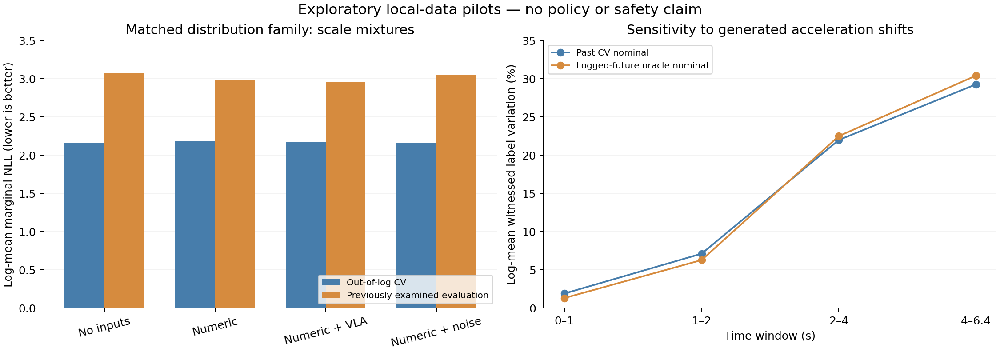

# Busca interdisciplinar e novos testes: física, informação e controle

**Decisão:** não promover um novo candidato a paper nesta rodada. A primeira melhora probabilística das features VLA diminuiu quando corrigimos a família de distribuição e exigimos controles comparáveis. A sensibilidade física indica uma pergunta mais substantiva: que parte da incerteza relevante para decidir pode ser resolvida pela observação, e que parte exige informação sobre a resposta dos agentes? Essa é uma direção de investigação, ainda sem método original ou ganho de política.

Protocolo anterior aos dois primeiros pilotos: [PROTOCOLO_FISICA_INFORMACAO_V1.md](PROTOCOLO_FISICA_INFORMACAO_V1.md). Controles de mistura e o terceiro piloto foram adicionados **após** ver os primeiros resultados, com esse caráter explicitado no protocolo. Todos os dados de avaliação já foram examinados em rodadas anteriores. Não há confirmação independente.

## 1. O que veio de outras áreas — e o que já existe

A busca incluiu física estatística, comparação de experimentos em estatística, teoria da informação, identificação de sistemas, controle robusto e jogos dinâmicos. A tabela distingue resultados dos autores de implicações nossas. Texto completo consultado nas quatro primeiras fontes e em deficiência; demais entradas usam página/resumo primário, sem alegar revisão integral ou reprodução.

| Fonte primária | Conteúdo relevante | Implicação para o projeto |
|---|---|---|
| [Mori–Zwanzig para abstração de crença, Autonomous Robots](https://link.springer.com/article/10.1007/s10514-024-10185-1) | A projeção de um estado completo produz termos de memória e ruído; os autores aprendem dinâmica de crença com memória e ações/observações históricas. A aplicação mostrada é planejamento de autonomia marinha. | “VLA + memória inspirada em física” já tem vizinho metodológico forte. A decomposição exata não oferece identificação automática do kernel a partir de imagens isoladas. |
| [Limits of Learning Linear Dynamics from Experiments](https://arxiv.org/html/2605.12010v1) | Caracteriza sistemas lineares compatíveis com um experimento e dinâmica identificável no subespaço alcançável. | O experimento determina que mecanismo se pode aprender. A generalização para VLA não decorre do teorema linear. Não vender “subespaço identificável” como novidade nossa. |
| [Multi-Agent Reachability Calibration, CDC2023](https://arxiv.org/html/2304.00432v2) | Calibra erros de previsão e os traduz em conjuntos alcançáveis, demonstrando uso em planejamento. | “Conformal + reachability + rede” já é uma combinação estabelecida. Precisamos de diferença formal além de aplicar ao nosso dataset. |
| [Prediction Sets for Counterfactual Decisions](https://arxiv.org/html/2607.02206v1) | A cobertura é acoplada à política quando ações alteram o resultado; analisa conjuntos e decisão robusta, com procedimento conformal. | Prever bem o futuro sob a política registrada não valida automaticamente decisões que mudam esse futuro. A própria interface contrafactual incerteza–ação já tem teoria recente. |
| [Variational Deficiency Bottleneck, IJCNN2020](https://arxiv.org/html/1810.11677v3) | Usa deficiência de canais e interpreta a aproximação de canais por diferença de risco ótimo. | “Preservar informação necessária para decisões” precisa de uma diferença mais precisa do que um bottleneck renomeado. |
| [Deciding What to Learn, ICML2021](https://proceedings.mlr.press/v139/arumugam21a.html) | Rate–distortion determina alvos de aprendizagem e compromisso informação–suboptimalidade. | Uma loss de informação mais custo não basta como contribuição nova. |
| [SPARC: Learned Image Compression for VLA](https://arxiv.org/abs/2606.16253) | Compressão visual destinada a preservar ações, alocando bitrate por região e câmera. | Compressão orientada à ação já aparece diretamente em VLA. |
| [Counterfactual Image Editing, ICML2024](https://proceedings.mlr.press/v235/pan24a.html) | Resultados de impossibilidade e relaxação causal para editar imagens sob modelos específicos. | O par de imagens não fornece sozinho o contrafactual físico nem a ação correta. |
| [Common-Witness Certificates](https://arxiv.org/abs/2609.03973) | Relações externamente justificadas permitem limites parciais para features de imagens; plausibilidade local não garante testemunha global comum. | Mesmo a proposta ampla de “limites de edição imperfeita” tem sobreposição recente. Não basta adicionar um intervalo. |
| [Nonrectangular robust MDPs, SIAM2026](https://epubs.siam.org/doi/10.1137/24M1631250) | Algoritmos e garantias para conjuntos de incerteza que não se decompõem por estado/ação. | Coerência temporal e dependência entre incertezas não são novidades isoladas. |
| [Active learning of human intentions in driving](https://arxiv.org/abs/2301.09178) | Planejamento em jogo/POMDP aprende estados cognitivos para mudança de faixa. | Atuar para inferir intenção já é explorado em direção. |
| [Decision-focused system identification: HVAC](https://arxiv.org/abs/2501.14708) | Aprende parâmetros de dinâmica ligados ao otimizador de controle em climatização. | A engenharia também já explora identificação orientada ao custo; transportar a ideia exige mecanismo e resultado próprios. |

Não inferimos prioridade ou ausência de trabalhos a partir de buscas sem resultados. Preprints de2026 não devem ser tratados automaticamente como trabalhos revisados por pares.

## 2. Piloto físico: estabilidade dos rótulos sob perturbações

Código: `src/cavla/physical_envelope_audit.py`. Artefatos: `artifacts/physical_envelope_v1_20261021/`.

Reutilizamos532 agentes de desenvolvimento e152 agentes/73 cenas/16 logs da avaliação anterior, com histórico passado válido. Mantivemos as32 curvas e os cinco intervalos temporais da auditoria anterior. As proporções abaixo são médias por log de proporções cena/query, sem fingir que cada curva é observação independente.

O futuro nominal é (a) velocidade constante a partir do passado3D, ou (b) o futuro registrado, usado como oráculo diagnóstico. Variamos apenas translações dos centros, mantendo orientação e tamanho nominais. Para um raio r(t)=r0+at²/2, a distância assinada à caixa é1-Lipschitz em translação. Isso dá condições suficientes para preservar o rótulo de proximidade e uma terceira resposta inconclusiva. O certificado vale nos64 timestamps discretos; não é garantia entre amostras.

Também geramos oito perturbações de aceleração constante, direções espaçadas por45graus, incluindo o nominal como nona possibilidade. Cada cenário usa uma direção comum para os agentes: é uma testemunha restrita e artificial, não um modelo de tráfego. Dois cenários discordantes provam variação do rótulo nesse conjunto gerado; falha do certificado, sozinha, não prova que exista tal variação.

Para **a=0.5m/s² e r0=0**, sem erro inicial adicional:

| Janela | CV: certificados inconclusivos | CV: variação testemunhada | Oráculo registrado: variação testemunhada |
|---|---:|---:|---:|
| 0–1s | 2.00% | 1.90% | 1.31% |
| 1–2s | 7.19% | 7.12% | 6.28% |
| 2–4s | 22.86% | 22.00% | 22.51% |
| 4–6.4s | 30.79% | 29.29% | 30.43% |

A varredura completa usa r0 em0/0.25/0.5m e a em0/0.25/0.5/1/2m/s². A magnitude final do deslocamento cresce quadraticamente: a=0.5 implica10.24m em6.4s. Portanto, não descrever como mudança espacial pequena em todo o horizonte. Não calibramos esses raios como probabilidades de comportamento real.

O controle com futuro registrado mostra que a sensibilidade não é apenas erro do preditor CV. Isso **não** prova imprevisibilidade, necessidade de semântica ou resposta contrafactual real. Em particular, as perturbações podem sair da via e não respeitam velocidade, regras ou reação de outros agentes. O predicado continua sendo distância≤2m à caixa e não colisão com footprint do ego. As32 curvas nem sempre são manobras executáveis a partir do estado real.

A diferença relativamente pequena entre inconclusão e testemunhas neste recorte também não apoia, por si só, investir num método para reduzir conservadorismo de envelopes temporais: boa parte da sensibilidade já aparece em trajetórias acopladas simples.

Verificações: zero raio reproduziu **exatamente todos os rótulos** de CV e do futuro registrado nos dois conjuntos; nenhum certificado contradisse o nominal ou as testemunhas geradas.

## 3. Piloto de informação: prever dispersão sem corrigir a média

Código: `innovation_scale_probe.py`. Artefatos: `artifacts/innovation_scale_v1_20261021/`.

A média da previsão permanece CV. Predizemos variância isotrópica do resíduo2D em1/2/4/6.4s, com entrada numérica19, numérica+PCA16 VLA ou numérica+Gaussian16. PCA e normalização são ajustadas no treino. Ridge linear e RBF usam as grades anteriores e podem selecionar a variância global pela validação interna. O readout ajusta log-energia e corrige retransfomação somente no treino.

A métrica é NLL marginal por horizonte, média nos quatro horizontes e depois nos logs. NLL menor é melhor. Na avaliação, combinamos as três distribuições por mistura uniforme, calculando logsumexp: não substituímos a mistura pela variância média. Não avaliamos distribuição temporal conjunta.

| Modelo de dispersão | CV fora do log | Avaliação já usada |
|---|---:|---:|
| Variância global | 4.352 | 4.458 |
| Gaussiana linear, numérico | 4.333 | 4.504 |
| Gaussiana linear, numérico+VLA | 4.387 | 4.212 |
| Gaussiana RBF, numérico | 4.060 | 4.654 |
| Gaussiana RBF, numérico+VLA | 4.108 | 4.287 |

O ganho visual na avaliação é interessante, mas contradiz a ordenação em CV. Não converter redução de NLL em “bits de informação visual”: a identidade com informação mútua condicional exige condicionais verdadeiras/Bayes ótimas, que estes readouts estimados não fornecem.

## 4. Controle decisivo: caudas e mistura sem visão

Código: `scale_mixture_control.py`. Artefatos: `artifacts/innovation_scale_strong_controls_v1_20261021/`. Controle explicitamente pós-hoc.

A distribuição dos resíduos mistura agentes quase estacionários com erros maiores. Ajustamos misturas de Gaussianas2D isotrópicas de média zero, variância mínima0.01m², por EM ponderado igualmente por log. K em1/2/4/8, escolhido apenas na validação interna. Os três folds selecionaram8 componentes. Não entra imagem, classe, geometria ou velocidade no preditor da dispersão; o centro continua sendo CV.

A mistura incondicional obteve **NLL2.165 em CV e3.074 na avaliação**, vencendo amplamente as Gaussianas com visão. A hipótese de que o primeiro ganho visual, por si só, justificaria um candidato foi rejeitada. Isso não prova que toda informação visual seja inútil: a família de distribuição era diferente. Controles constantes adicionais, calibrados no treino/validação, estão registrados, sem selecionar retrospectivamente um deles para reportar.

## 5. Comparação com a mesma família de distribuições

Código: `conditional_scale_mixture.py`. Artefatos: `artifacts/conditional_scale_mixture_v1_20261021/`. Adendo escrito antes desta execução, mas após os resultados anteriores.

Congelamos variâncias/componentes da mistura escolhida no treino/validação. Aprendemos somente pesos de mistura por softmax linear, com numérico, numérico+VLA ou numérico+ruído. Todos usam a mesma distribuição, NLL ponderada por log, otimização direta por L-BFGS, quatro regularizações e possibilidade de manter a mistura incondicional. A seleção permanece na validação interna. Todos os36 ajustes de gating convergiram.

| Modelo de mistura | CV fora do log | Avaliação já usada |
|---|---:|---:|
| Incondicional | 2.165 | 3.074 |
| Condicional numérico | 2.191 | 2.982 |
| Condicional numérico+VLA | 2.179 | 2.958 |
| Condicional numérico+ruído | 2.163 | 3.047 |

VLA menos numérico: **−0.0247 NLL**, intervalo condicional de95% por bootstrap de16 logs **[−0.0840,+0.0252]**. Melhora pontual em10/16 logs, sem confirmação de vantagem incremental. Em CV, VLA permanece pior que mistura incondicional e controle de ruído. Bootstrap condiciona modelos fixos, não incorpora retreino nem corrige a busca adaptativa de hipóteses.

**Decisão:** não escalar “features VLA para prever incerteza” como candidato principal neste protocolo. O método simples de mistura fica como baseline para futuros testes. Não provar ausência geral de informação visual ou rejeitar vídeo, features de outras camadas ou outra população.

Figura exportável: `docs/plots/physical_information_20261021.pdf`. NLL e sensibilidade são tarefas diferentes, não métricas de direção.

## 6. A aposta de pesquisa após estes resultados

Minha prioridade passa a ser **identificação da informação necessária para distinguir decisões**, antes de escolher uma arquitetura. A pergunta específica é: diante de modelos de resposta dos agentes que concordam com os dados observados, quais decisões continuam equivalentes e qual observação/intervenção adicional consegue separá-las?

Uma formulação de trabalho é M(D), conjunto de mecanismos compatíveis com dados e hipóteses explicitadas, e

    R(a;D) = sup_{m em M(D)} [J_m(a) - min_b J_m(b)].

Menor R indica menor pior arrependimento entre mecanismos ainda compatíveis. Observar uma imagem, recuperar histórico ou executar um experimento só é útil para essa formulação se reduzir legitimamente M(D) nas direções que mudam a decisão. Se uma semântica não restringe a resposta dos agentes, não se deve reduzir o conjunto apenas por alta confiança textual.

**Esse objetivo robusto é conhecido; não é nosso teorema nem método novo.** Para virar candidato ICML, precisaremos de uma forma nova e demonstrável de construir/atualizar o conjunto com supervisão multimodal incompleta, com hipóteses verificáveis e ganho além de baselines robustos, inferência de intenção e aquisição por entropia. PC-RACP, deficiência, identificação experimental e controle robusto são os concorrentes conceituais, não apenas outras VLAs.

Três caminhos são mantidos separados:

1. **Informação visual sobre inovação física:** já testada nesta rodada, sem ganho incremental convincente contra a mistura numérica. Pausar este protocolo como candidato.
2. **Memória mínima para resolver a decisão:** motivada por observabilidade/Mori–Zwanzig, mas precisa testar vídeo passado com supervisão suficiente e superar CV/aceleração constante, história3D, filtro multimodal e RNN simples. Não chamar apenas inclusão de memória de novidade. Não iniciado nesta rodada.
3. **Decisões sob intervenção visual imperfeita:** tem maior afinidade com Counter-nuScenes, mas exige referência externa para limitar o que o editor preservou. Sham-edit/edição repetida sem hipótese de invariância não identifica o efeito físico; interações com editor já observadas impedem assumir efeito aditivo. Não iniciado novo treinamento.

A barreira anterior a qualquer adaptação grande é escolher um problema em que duas explicações observacionalmente compatíveis mudem de fato a decisão, definir a informação extra que as separa e verificar sua disponibilidade. Para afirmações de reação dos agentes, os pares de remoção e um futuro registrado não bastam; será necessário experimento com resposta verificável, em simulação ou dados apropriados. CARLA não é obrigatório como ferramenta específica. O dataset local continua útil para as observações, intervenções visuais e controles de domínio, mas não fornece sozinho toda a supervisão requerida.

Não foi estabelecida novidade suficiente em nenhum dos três caminhos. A busca interdisciplinar restringiu propostas frágeis e tornou os controles mais exigentes; não deve ser apresentada como paper concluído ou contribuição já validada.

## Reprodução e verificação

Os quatro módulos aceitam `--out` para diretório novo. Executar na ordem `physical_envelope_audit`, `innovation_scale_probe`, `scale_mixture_control`, `conditional_scale_mixture`; os dois últimos usam os artefatos anteriores nos paths registrados no código. `PYTHONPATH=src OPENBLAS_NUM_THREADS=2 python -m cavla.NOME --out DIRETORIO_NOVO` reproduz a primeira execução a partir dos caches fixos existentes. Os paths dos estudos anteriores usados como entrada estão explícitos no código; mudar o diretório do segundo/terceiro exige atualizar essas referências, não há roteamento automático entre diretórios novos. Fontes de execução preservadas em cada pasta.

As métricas dos três estudos probabilísticos foram recalculadas a partir das predições salvas: diferença máxima **0.0** em todos.

**79 testes passaram** com o Python existente que tem PyTorch. Incluem recuperação de escala heteroscedástica sintética, gradiente analítico do gating conferido por diferenças finitas, monotonicidade de EM, normalização da mistura e validade de certificados geométricos. Log: `artifacts/tests_physical_information_final_20261021.log`. A primeira tentativa da suíte completa usou Python do sistema e falhou por falta de PyTorch em testes antigos; o log foi preservado. Não houve instalação ou alteração de ambiente.

Todos os experimentos desta rodada usaram CPU e caches locais. Nenhum checkpoint foi baixado, nenhuma execução adicional de backbone/GPU foi necessária e nenhuma política de direção foi avaliada.
