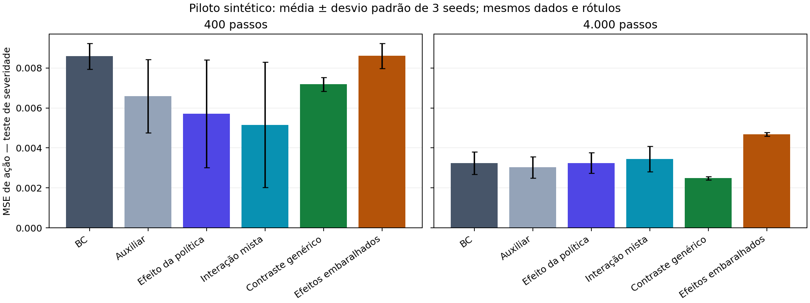
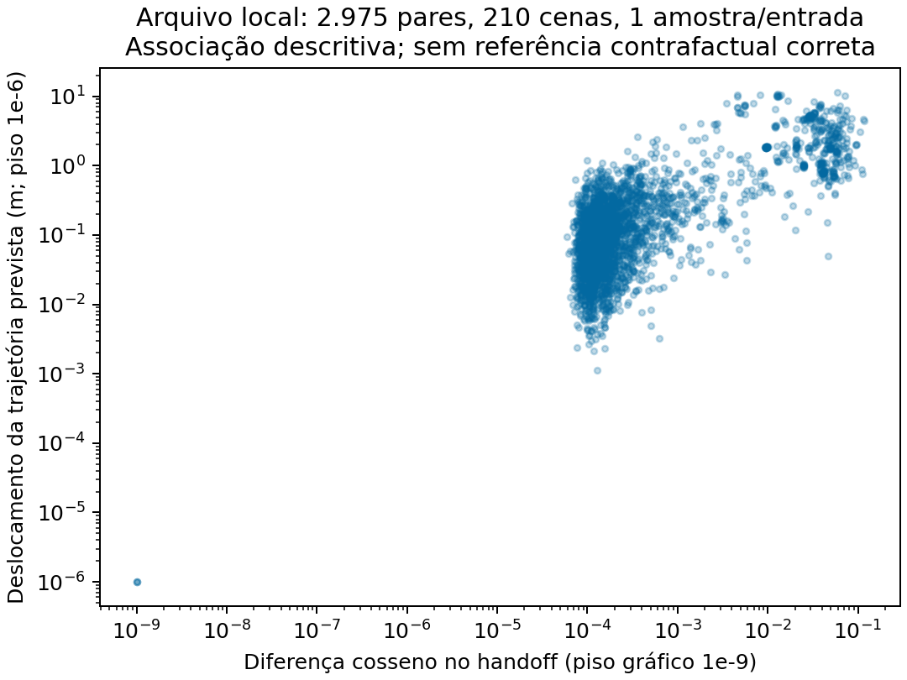
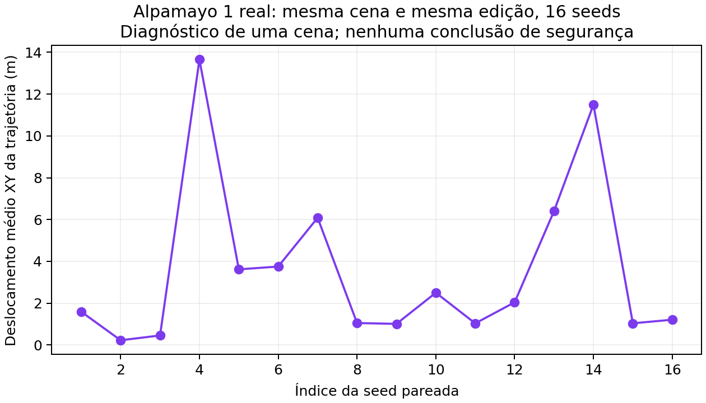

# Resultados iniciais executados — 20/10/2026

**Estado: investigação em andamento; nenhum resultado estabelece ainda uma contribuição de nível ICML.**

## Decisão

Não escalar a loss simples de alinhamento de efeitos. O ganho de extrapolação do piloto curto não se sustentou após mais treino frente ao contraste genérico. Há ganhos em outras métricas, mas nenhum método domina todos os shifts.

## Pilotos controlados

36 treinos: seis objetivos × três seeds × dois orçamentos (400 e 4.000 passos). Mesmas 768 cenas de treino, 256 de validação e 512 por teste. Quatro vistas por cena; todos os métodos recebem os mesmos rótulos. É uma CNN com IDs de comandos em um problema de decisão sintético de um passo, sem VLA pré-treinada ou validação física.

MSE de ação após 4.000 passos, média das três seeds. Unidades normalizadas do problema sintético; menor é melhor.

| Método | ID | Severidade não vista | Fundo invertido |
|---|---:|---:|---:|
| BC | 0.00000811 | 0.00324319 | 0.00494649 |
| Auxiliar | 0.00000455 | 0.00302585 | 0.00625793 |
| Efeito da política | 0.00000378 | 0.00324161 | 0.00413213 |
| Interação mista | 0.00000326 | 0.00344438 | 0.00230639 |
| Contraste genérico | 0.00000996 | 0.00248230 | 0.01131642 |
| Efeitos embaralhados | 0.00080537 | 0.00467817 | 0.02718311 |

A interação mista melhora ID e fundo neste conjunto, mas tem erro de severidade maior que BC na rodada longa; o contraste genérico é o melhor nesta última métrica. Isso impede atribuir um ganho geral ao componente causal proposto. A configuração é exploratória; não houve busca de lambda e uma única base de treino foi usada. Seeds variam inicialização e ordem de minibatches.

Validação ID seleciona checkpoints; resultados de teste não os selecionam. Os ICs no JSON são bootstrap por cena condicionado aos modelos treinados. As médias por seed também estão salvas; esses ICs não capturam toda a variabilidade de retreinar com outro conjunto de dados.

## Auditoria de arquivos reais

Reanalisados **2,975 pares em 210 cenas**, sem exclusões. Todos os pares deste diretório têm uma amostra de trajetória e seed registrada 123. O artigo CVAA descreve também outros experimentos; não extrapolamos a limitação deste arquivo a todo o trabalho.

A correlação de Spearman descritiva entre diferença no handoff e deslocamento previsto é **0.586**. Isto mede resposta do modelo, sem indicar se ela é correta.

Em **18.1%** dos pares, a alteração absoluta de minADE é menor que metade do deslocamento direto da previsão. A correspondência inequívoca com bounding boxes atuais cobre **91.7%**; joins ambíguos são tratados como ausentes.

A sonda de regressão usa cinco folds separados por cena, normalização e imputação ajustadas somente no treino, e alpha fixo. Sua comparação é exploratória; ela não aprende alvos causais corretos. Mais detalhes e resultados por fold estão nos artefatos.

## Inferência nova no Alpamayo real

Checkpoint Alpamayo-R1-10B local, executado offline. Lote inicial de quatro seeds seguido de lote ampliado de 16 seeds; o lote ampliado inclui as quatro iniciais e não é replicação independente delas. No lote ampliado foram 33 inferências: original e editada para cada seed, mais repetição idêntica da original com a primeira seed.

Na repetição com mesma entrada/seed, deslocamento **0.000000 m**. Para a edição fixa, deslocamento por seed entre **0.223 e 13.652 m**, mediana **1.813 m**.

A repetibilidade de uma entrada não torna o contraste entre entradas independente do acoplamento aleatório. Distâncias entre seeds da original são diversidade de amostras, não erro-padrão da média. Usamos uma única cena e um único objeto: não estimamos prevalência deste comportamento no dataset.

Os estimadores de efeito médio quadrático e MMD estão implementados como ferramentas estatísticas padrão. Valores finitos, inclusive negativos, são preservados. Não reportamos teste de significância nem intervalo calibrado com este estudo de uma cena. A U-estatística de média assume pares independentes entre seeds, não confere validade causal física ao resultado.

O protocolo replica um único frame frontal e padding das demais posições. Não substitui validação nativa multiview/temporal. O modelo original não implementa condicionamento explícito de navegação; os arquivos não testam a hipótese de interação com instrução em uma VLA real.

## Próxima decisão experimental

Antes de treinar uma VLA grande: ampliar respostas estocásticas para várias cenas/objetos com protocolo nativo validado; definir referência externa para o efeito correto; comparar o método candidato com ECT/CRAFT, supervisão auxiliar e contraste genérico. Qualquer contribuição sobre segurança exigirá avaliação de comportamento compatível com essa alegação.

## Artefatos

- `artifacts/real_audit_20261020/`: pares, folds, hashes dos CSVs-fonte, sondas e limitações.
- `artifacts/controlled_20261020/` e `artifacts/controlled_convergence_20261020/`: manifestos, curvas, checkpoints, previsões e métricas por seed.
- `artifacts/alpamayo_repeatability_20261020/` e `artifacts/alpamayo_repeated16_20261020/`: inferências novas, seeds, configuração e procedência.
- `src/cavla/` e `tests/test_core.py`: implementação e testes de validade dos controles.
