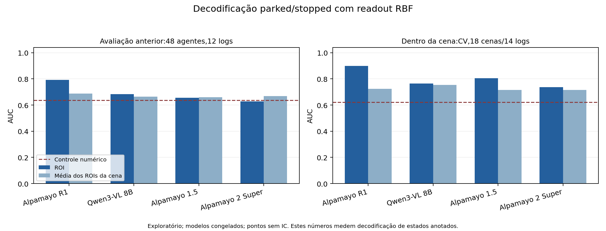

# Replicação multimodelo e discriminação dentro da cena

**Resultado:** executamos backbones congelados de três checkpoints VLA — Alpamayo R1, 1.5 e 2 Super — e Qwen3-VL 8B como controle geral. O R1 manteve o maior ponto de AUC nesta sondagem. A análise de 18 cenas mistas dá evidência exploratória de informação útil para distinguir agentes no mesmo contexto. Ainda faltam avaliação independente com cenas mistas suficientes, utilidade de decisão e um método novo.

## Modelos e execução local

Inventário: `artifacts/local_vla_inventory_20261021.json`. Há pesos completos locais dos três Alpamayos e de Qwen3-VL 2B/8B. Cosmos-Reason2-8B tem arquivos de configuração/tokenizer, mas nenhum arquivo de pesos no snapshot inspecionado. Qwen-Drive não foi encontrado nas buscas locais por diretório e configuração; **Qwen3-VL não é Qwen-Drive**. O [repositório oficial do Qwen-Drive](https://github.com/QwenLM/Qwen-Drive-1.0) descreve uma arquitetura com backbone Qwen3.5 e módulos próprios de percepção/planejamento.

Usamos a RTX PRO6000 Blackwell de 96 GB. Extrações principais:4 checkpoints × 127 cenas, 288 agentes por checkpoint. Somente o backbone VLM foi carregado e executado; **nenhuma trajetória foi gerada ou política avaliada nesta rodada**. Não foram alterados pesos, ambientes ou fontes compartilhadas dos modelos.

| Checkpoint | Parâmetros do backbone carregado | Pico CUDA alocado pelo processo |
|---|---:|---:|
| Alpamayo R1 | 8,798 bilhões | 17,74 GiB |
| Qwen3-VL 8B | 8,767 bilhões | 17,68 GiB |
| Alpamayo 1.5 | 8,798 bilhões | 17,74 GiB |
| Alpamayo 2 Super | 33,397 bilhões | 64,94 GiB |

Os valores excluem o expert de ações e distinguem memória alocada do uso total mostrado pelo nvidia-smi. Para o Super, o uso total observado ficou próximo de 70.000 MiB, incluindo processos preexistentes e reserva do CUDA.

## Comparação controlada

[Protocolo](PROTOCOLO_MULTIMODELO_SEMANTICO_V1.md). Mantivemos os 288 agentes da rodada anterior, as imagens e caixas, o prefixo visual com 16 slots e frontal no slot 12, grid 10×18, pooling fracionário, PCA16, três splits por log e seleção apenas pela validação interna. Os48 agentes/12 logs da avaliação já foram examinados em rodadas anteriores. São 13 stopped e35 parked.

As quatro profundidades são [8,16,24,36] nos backbones de 36 camadas e [14,28,43,64] no Super. A extração não usa a resposta de planejamento nem compara protocolos nativos de direção de cada modelo. O input frontal estático com câmeras preenchidas por preto é uma condição de pesquisa compartilhada; não é avaliação completa das capacidades multicâmera/temporais dos modelos.

Verificamos que todos os tensores treinados esperados foram carregados do checkpoint, sem parâmetros meta ou ausentes. Os prefixos visuais e imagens coincidem por hash em todas as 127 cenas para os quatro checkpoints. Cada comparação de contexto usa a mesma população de ROIs selecionados: original, média da cena ou original menos média da cena.

## Resultados globais

| Representação | AUC logística na avaliação | AUC RBF na avaliação | AUC RBF média de CV | Erro balanceado RBF na avaliação |
|---|---:|---:|---:|---:|
| Apenas dados numéricos | 0,500 | 0,637 | 0,694 | 40,04% |
| Alpamayo R1 | 0,816 | 0,792 | 0,823 | 28,46% |
| Qwen3-VL 8B | 0,729 | 0,684 | 0,762 | 35,90% |
| Alpamayo 1.5 | 0,685 | 0,655 | 0,757 | 35,82% |
| Alpamayo 2 Super | 0,703 | 0,627 | 0,686 | 50,00% |

Todos recebem os mesmos dados numéricos passados além da representação correspondente. Não escolhemos retrospectivamente a melhor família por checkpoint. AUC e erro balanceado podem divergir: o threshold do erro é escolhido na validação, e não recalibrado na avaliação.

O ponto do R1 supera Qwen nesta tarefa, mas o intervalo pareado por log da diferença RBF inclui zero: +0,108, intervalo de 95%[-0,028;+0,317]. A separação R1 versus1.5 tem ponto+0,137 e intervalo [+0,051;+0,233]. Esses intervalos são condicionais aos modelos fixos e não corrigem seleção de hipóteses/múltiplas comparações. Não identificam efeito causal do treinamento VLA; dados e objetivos de pré-treino diferem. Também não constituem ranking de desempenho de direção.

Resultados completos: `artifacts/semantic_multimodel4_v1_20261021/`.

## O controle dentro da mesma cena

O desenvolvimento tem 18 cenas com ambas as classes,61 agentes e14 logs. Usamos predições de teste fora do log de treino em cada fold; calculamos AUC por cena e depois a média das cenas mistas. Isso evita obter uma AUC alta apenas por atribuir um escore diferente a cada rua/cena.

| Entrada, família RBF | AUC média dentro da cena, CV |
|---|---:|
| Apenas dados numéricos | 0,622 |
| ROI Alpamayo R1 | 0,899 |
| Média dos ROIs R1 da cena + dados numéricos | 0,724 |
| ROI R1 menos média da cena + dados numéricos | 0,854 |
| ROI Qwen3-VL 8B | 0,764 |
| ROI Alpamayo 1.5 | 0,806 |
| ROI Alpamayo 2 Super | 0,736 |

R1 menos controle numérico: +0,276, bootstrap pareado de 14 logs, intervalo de 95%[+0,098;+0,532]. R1 menos média da cena: +0,175, intervalo [-0,019;+0,453]. Portanto, há sinal exploratório além da geometria, mas a amostra ainda deixa incerta a separação completa entre informação do agente e contexto representado pela cena. Centralizar features não é intervenção causal no contexto da imagem.

Na avaliação separada, continua existindo **uma única cena mista, cinco agentes e um log**. Reportamos os pontos por transparência, sem intervalo inferencial nesse recorte. Essa limitação impede uma confirmação independente do resultado dentro da cena.

Auditoria: `artifacts/semantic_within_scene4_v1_20261021/`.

## Verificação do extrator e pilotos descartados

O primeiro carregamento encontrou buffers de RoPE não persistentes em dispositivo meta. Reconstituímos somente essas constantes determinísticas e mantivemos a exigência de carregar todos os parâmetros treinados do checkpoint. Os pilotos falhos não produziram features utilizadas.

Uma segunda checagem detectou que o Transformers instalado captura o hidden state final normalizado ao chamar o módulo interno `model.model`, enquanto a extração anterior usava o wrapper condicional. Esses pilotos foram marcados `INVALID.json` e excluídos. As extrações principais usam o wrapper condicional com logits limitados a um token, economizando memória sem mudar as camadas extraídas.

Reextraímos também o R1 inteiro pelo caminho comum. Uma comparação de três ROIs com a implementação nativa inicialmente tinha L2 relativo 0,91%, cosine mínimo 0,99997. O prefixo visual era idêntico, mas o tokenizer geral expandia os placeholders posteriores às imagens para 3264 tokens totais, contra 3006 no nativo. Em checagem adicional, igualar esse comprimento e zerar somente IDs posteriores ao último token visual produziu **diferença máxima 0,0** com as features nativas. O caso documenta sensibilidade numérica ao caminho/comprimento da entrada em BF16; o teste exato valida a captura e os pesos. A comparação principal mantém o mesmo prompt comum para todos os quatro checkpoints, inclusive a nova baseline R1.

Checagens: `semantic_backbone_loader_check_v4_20261021/numeric_check.json` e `semantic_backbone_loader_check_v5_20261021/numeric_check.json`. O Super preserva `executed_source_snapshot.py` para distinguir o código que estava em execução de uma opção de diagnóstico adicionada durante a execução; o comportamento padrão da extração não mudou.

## Aumentar o conjunto exige mudar a seleção

Auditamos os candidatos automáticos existentes sem exigir6,4s de futuro completo. No pool de desenvolvimento, o recorte quase parado parked/stopped passa de 239 para 354 agentes e de 18 para 26 cenas mistas. No pool de avaliação anterior, passa de 48 para 60 agentes e de 21 para 31 cenas, **mas permanece com uma única cena mista**. O inventário usa velocidade3D mundial; por isso difere em um agente do recorte anterior com velocidadeXY no ego.

Esse aumento de cobertura não resolve o gargalo da avaliação. O próximo conjunto deve incluir veículos anotados presentes nas imagens originais além dos alvos de remoção que já tinham associação automática. Isso preserva o uso das imagens locais e pode fornecer pares de agentes no mesmo contexto. A seleção precisa ser definida por disponibilidade/estado observado, sem olhar o erro ou a resposta dos modelos.

Inventário e candidatos: `artifacts/semantic_selection_audit_v1_20261021/`. Nenhuma ação contrafactual correta foi gerada por essa auditoria.

## Decisão para o projeto

Há uma base experimental mais concreta para investigar **quando informação sobre o papel de outro agente, além de sua cinemática, deve modificar uma decisão**. A nova rodada fortalece a evidência de decodificação visual e oferece controles multimodelo e dentro da cena. Não resolve a transferência de decodificação para ação: o teste anterior de gate semântico não venceu convincentemente a previsão estacionária, e há somente um evento de partida no pequeno conjunto de avaliação.

O próximo investimento deve obter cenas mistas/eventos suficientes e uma decisão verificável, antes de acrescentar um objetivo de treinamento. Classificação de estados, loss auxiliar de intenção ou troca de checkpoint continuam insuficientes como contribuição principal ao ICML. A novidade do método e o ganho de política ainda não estão estabelecidos.

Validação:72 testes passaram. Há um teste adicional em que um escore puramente de cena obtém AUC global alta e AUC dentro da cena 0,5, verificando a razão para este controle. As métricas finais também foram recalculadas a partir das predições e os hashes dos prefixos/ordem dos objetos foram auditados. Log: `artifacts/tests_multimodel_final_20261021.log`.
