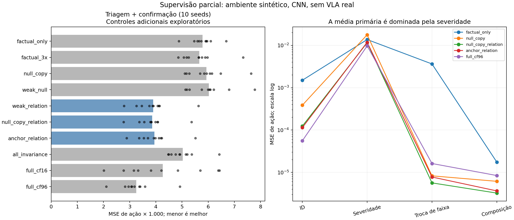
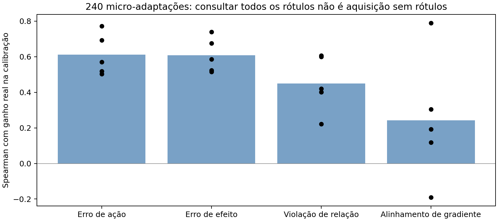

# Novas ideias e testes — 20/10/2026

A supervisão parcial por relações tem um sinal reproduzível neste ambiente
sintético. Entretanto, uma restrição simples com âncora conhecida reproduz quase
todo o ganho: não há evidência de que alinhamento de representação seja necessário.
Selecionar exemplos pelo erro de efeito não superou o erro comum de ação.
Nenhum desses resultados estabelece uma contribuição pronta para ICML.

## O que foi executado

- Dez pré-treinos factuais, 2.000 passos cada.
- Oito métodos × cinco seeds de triagem + oito × cinco seeds de confirmação:
  80 adaptações de 1.200 passos, com configuração congelada entre as fases.
- Dois controles adicionais × dez seeds: 20 adaptações exploratórias.
- Quarenta e oito candidatos × cinco seeds: 240 micro-adaptações de 40 passos.
- Smoke separado, não incluído nas médias, e 36 testes automatizados aprovados.

Todos os treinos usam a CNN visual de duas faixas e dois IDs de comando. Não
treinamos uma VLA real nesta rodada, nem usamos CARLA. A referência é uma função
de decisão de um passo, sem dinâmica física ou segurança em malha fechada.

## Hipótese 1: relações sem ação contrafactual exata

Protocolo anterior às execuções: [relações v1](PROTOCOLO_RELACOES_V1.md).
Treino: 224 cenas factuais e 448 vetores de ação conhecidos. Em 96 dessas cenas
geramos intervenções, balanceadas entre aproximação, troca de fundo e billboard.
O método fraco recebe 384 categorias escalares de relação, incluindo muitos
zeros, sem receber o valor correto da ação editada. Os rótulos são perfeitos e
produzidos pelo simulador; seu custo humano não foi medido.

Validação independente: 96 cenas factuais. Testes: 256 cenas por grupo, quatro
grupos por seed; checkpoint escolhido somente pela validação factual. As cenas
factuais dos pares de treino são intencionalmente conhecidas; os mundos editados
e todas as cenas de avaliação são novos. Isso é supervisão parcial adicional,
não uma melhora com exatamente a mesma informação da baseline factual.

Gate registrado: reduzir a média primária em >=10% contra factual e augmentação
nula; vencer cada uma em >=4/5 seeds; preservar ID. As duas variantes direcionais
passaram tanto na triagem como na confirmação. A confirmação usou cinco seeds
predefinidas, sem alterar passos, margem, peso ou gerador.

| Método | Triagem: MSE primária ×1.000 | Confirmação: MSE primária ×1.000 |
|---|---:|---:|
| Continuação factual | 5,780 | 5,798 |
| Augmentação nula válida | 6,118 | 5,757 |
| Consistência só de relações zero | 6,203 | 5,853 |
| Relações zero + direção | 4,012 | 3,787 |
| Augmentação nula + direção | 3,949 | 3,774 |
| Forçar invariância em tudo | 5,152 | 4,903 |
| 16 cenas com novas ações exatas | 4,403 | 4,125 |
| 96 cenas com novas ações exatas | 3,327 | 3,172 |

Na confirmação, augmentação nula + direção reduziu a média em **34,45%** contra
augmentação nula e em **34,92%** contra factual, vencendo ambos em 5/5 seeds.
Nas dez seeds juntas, a redução contra augmentação nula foi **34,97%**, com
10/10 vitórias. A supervisão completa de 96 cenas continuou melhor: o método
fraco tem erro **18,81% maior** na média combinada. Não há equivalência de custo
entre relações e trajetórias exatas; 16/96 cenas exatas acrescentam 32/192 novos
vetores de ação editada, além das âncoras já conhecidas.

O grupo de severidade domina numericamente a métrica primária. Para a variante
nula + direção nas dez seeds: severidade 0,011574; troca de faixa 0,00000565;
composição 0,00000325. Logo, a manchete de 35% não demonstra ganhos igualmente
grandes em três mecanismos difíceis. Troca de faixa e composição já ficam quase
resolvidas por augmentação nula, evidenciando a simplicidade do ambiente.

## Controles adicionais: o ganho exige a formulação proposta?

[Adendo](ADENDO_RELACOES_CONTROLES.md) escrito depois da triagem e antes destes
controles. São exploratórios e não redefinem o gate.

| Método, dez seeds | MSE primária ×1.000 | Segundos médios de adaptação |
|---|---:|---:|
| Factual, 1.200 passos | 5,789 | 1,30 |
| Factual, 3.600 passos | 5,660 | 4,14 |
| Augmentação nula, 1.200 passos | 5,937 | 2,47 |
| Relações sobre duas previsões | 3,899 | 2,78 |
| Augmentação nula + direção | 3,861 | 2,91 |
| Restrição direta sobre ação editada e âncora conhecida | 3,945 | 3,02 |
| 96 cenas com novas ações exatas | 3,250 | 2,14 |

Mais treino factual não eliminou o sinal; nula + direção venceu factual 3× em
10/10 seeds, com redução média de 31,78%. Entretanto, a baseline ancorada ficou
a apenas 2,11% do erro de nula + direção. Esta diferença pequena não é evidência
de contribuição algorítmica. A informação parcial acrescentada explica a maior
parte do resultado, sem necessidade de uma nova representação causal.

Tempos são medições locais de treino da CNN, incluem as validações e não incluem
todo o pipeline nem anotação. Controles rodaram em momentos de concorrência de
GPU; não usar pequenas diferenças de tempo como benchmark de eficiência.

## Hipótese 2: erro de efeito prevê utilidade de corrigir um exemplo?

[Protocolo](PROTOCOLO_UTILIDADE_V1.md) anterior ao cálculo de utilidades.
O teste acessou os rótulos de **todos** os 48 candidatos por seed. Cada pequena
adaptação reiniciou no mesmo modelo e usou replay factual idêntico por seed.
Utilidade = redução real de MSE em calibração independente dos candidatos,
após 40 passos. Nenhum teste final de relações foi usado neste diagnóstico.

| Proxy | Spearman médio com ganho real, cinco seeds |
|---|---:|
| Erro de ação editada | 0,611 |
| Erro de efeito | 0,607 |
| Violação de relações categóricas | 0,450 |
| Alinhamento de gradiente de primeira ordem | 0,243 |

O erro de efeito superou o erro de ação em apenas 2/5 seeds; a violação de
relações, em 0/5. Ambos falharam no gate de melhorar a correlação média em pelo
menos 0,10 e vencer em >=4/5. A influência de primeira ordem também não foi uma
boa previsão destes 40 passos AdamW, o que não refuta DataMIL/QoQ nem estimadores
de influência mais elaborados.

As correlações e o top-8 são diagnósticos nessa calibração. Não testamos a
generalização de um seletor aprendido; não há economia de anotação demonstrada.

## Pesquisa de trabalhos próximos e ideias priorizadas

Fontes primárias consultadas nesta rodada:

- [DataMIL](https://arxiv.org/abs/2505.09603): seleção de dados orientada à
  melhora da política; impede vender simplesmente “selecionar pelo ganho” como novidade.
- [Quality over Quantity](https://arxiv.org/abs/2603.09056): curadoria por
  influência sobre perda de validação; baseline próximo para estimar utilidade.
- [Learning Loss for Active Learning](https://openaccess.thecvf.com/content_CVPR_2019/html/Yoo_Learning_Loss_for_Active_Learning_CVPR_2019_paper.html):
  aprender a prever perda já é uma abordagem estabelecida de aquisição.
- [D-COACH](https://repository.tudelft.nl/record/uuid:281fb83a-4f11-4b57-a8af-8f930ced28ea):
  aprende políticas por correções humanas; supervisão fraca/direcional não é nova
  por si só. Feedback corretivo da ação e relação entre dois mundos não são
  objetos idênticos, mas a distinção precisa justificar um problema novo útil.
- [The Linear Representation Hypothesis for VLA](https://arxiv.org/abs/2609.30996):
  formula probing e steering com estrutura dinâmica; ameaça próxima para uma
  futura narrativa de “direções causais” no latente. Consultamos o resumo, sem
  reproduzir o método nem estabelecer uma distinção técnica completa.

A comparação com ECT/CRAFT e os demais trabalhos já catalogados continua
pendente em profundidade; esta busca não é uma certificação de novidade.

**Aposta de curto prazo:** investigar quando relações parciais válidas realmente
substituem ações/trajectórias exatas. A pergunta nova a resolver seria obter
relações úteis e confiáveis sob instruções e dinâmica, medindo custo e erros,
com transferência além do mecanismo observado. O piloto só demonstra que
relações perfeitas ajudam uma CNN num problema construído para isso.

Próximos testes que justificam mudar de escala:

1. Ambiente com dinâmica e ações acopladas: direção local pode inverter com
   horizonte, velocidade ou rota; exigir referência independente e malha fechada.
2. Relações incompletas/erradas e opção de abstenção, com níveis fixados antes
   das execuções. Comparar a baseline ancorada e supervisão de ação exata sob
   custos efetivamente medidos, sem inventar equivalência de anotação.
3. Segundo backbone e instruções que mudem a validade da própria relação;
   teste de generalização por mecanismo, e não apenas por seed/nível de distância.
4. Só depois, VLA real com entrada nativa, validação da intervenção e comparação
   com os concorrentes diretos. CARLA é uma escolha de infraestrutura, não
   requisito lógico desta hipótese.

Não ampliar aquisição por erro de efeito com base no diagnóstico negativo.
Não apresentar o resultado positivo como novo alinhamento causal de representação.

## Artefatos e reprodução

- `artifacts/relations_v1_20261020/`: triagem, 40 adaptações.
- `artifacts/relations_confirmation_v1_20261020/`: confirmação, 40 adaptações.
- `artifacts/relations_controls_v1_20261020/`: 20 controles e resumo combinado.
- `artifacts/utility_probe_v1_20261020/`: 240 utilidades individuais e proxies.

Os diretórios preservam protocolos, snapshots de código, hashes, curvas,
checkpoints de relações e predições por cena. Os scripts nunca substituem um
diretório de resultados existente. A anotação de contagem do manifesto inicial
de utilidade foi esclarecida em `metadata_correction.json`: calibração = 384
vetores de ação por seed; isso não altera dados ou resultados.

Usar o interpretador de treino existente e `PYTHONPATH=src`, com
`CUBLAS_WORKSPACE_CONFIG=:4096:8 OPENBLAS_NUM_THREADS=2`. Módulos:
`cavla.relations`, `cavla.utility_probe`, `cavla.relation_controls` e
`cavla.relations_report`. As configurações exatas estão nos manifestos e
protocolos. A confirmação usa `--seeds 1121 1222 1323 1424 1525`.

Verificação: `python -m unittest discover -s tests`, 36 testes aprovados;
incluem isolamento da ação editada no trainer fraco, validade dos rótulos nulos,
ausência de sobreposição entre avaliação e treino, e aplicação correta do gate.
