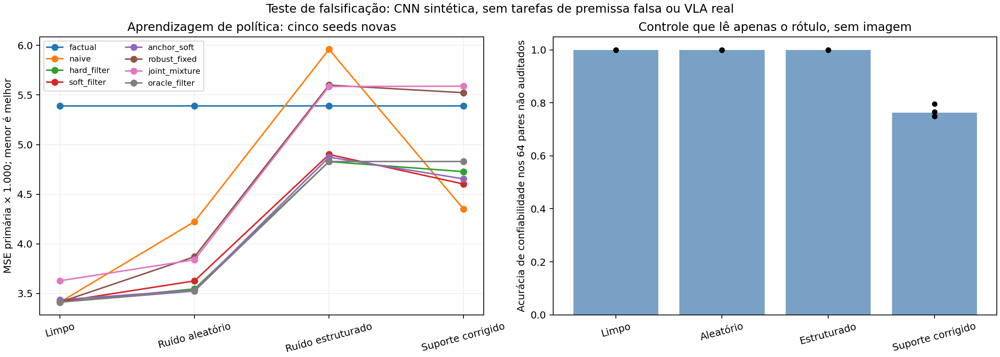

# Supervisão incerta: pesquisa, aprendizagem e validação dos dados

20/10/2026. **A mistura conjunta de confiabilidade e política foi rejeitada
nesta configuração.** Ela não superou os filtros simples e falhou no gate
registrado. Não escalar essa formulação como contribuição para ICML.

O trabalho desta rodada inclui treinamento de política, além da auditoria dos
pares reais. Os treinos são controlados/sintéticos; não foi feito fine-tuning de
uma VLA real com rótulos contrafactuais inventados.

## Execuções válidas

- Cinco novos pré-treinos factuais, seeds 1636, 1747, 1858, 1969, 2080.
- Nove métodos × três regimes × cinco seeds: **135 adaptações** de 1.200 passos.
- Nove métodos × cinco seeds com controle de suporte: **45 adaptações**, usando
  os mesmos checkpoints factuais, sem novo pré-treino.
- Total científico: **180 adaptações**. Não contar smoke nem execução v1 inválida.
- **44 testes automatizados aprovados**, incluindo isolamento dos alvos ocultos,
  corrupção, efeitos por componente, endpoints da mistura e diagnóstico visual.

[Protocolo registrado](PROTOCOLO_SUPERVISAO_INCERTA_V1.md),
[correção técnica](CORRECAO_SUPERVISAO_INCERTA_V2.md) e
[adendo exploratório](ADENDO_SUPORTE_ROTULOS.md) preservam a ordem das decisões.
A primeira execução foi interrompida por clipping incorreto de probabilidades
certas: permitia ignorar uma restrição aprovada pelo auditor. Foi marcada como
inválida, corrigida e repetida integralmente, sem mudar hiperparâmetros.

## O que foi testado, precisamente

CNN visual de duas faixas, dois comandos, referência de um passo. Treino factual
com 224 cenas; 96 pares de intervenção nas cenas factuais conhecidas; validação
independente de 96 cenas; quatro grupos de teste de 256 cenas cada, por seed.
Não há dinâmica, direção real, comandos com referente ausente nem decisão de
esclarecimento. É um teste de **supervisão de efeito errada**, não uma reprodução
da invalidade semântica completa que queremos estudar em Counter-nuScenes.

Cada método com auditorias recebe os mesmos **32 bits** sobre confiabilidade de
pares escolhidos aleatoriamente, sem rótulos de relação corrigidos ou ações
editadas exatas. Os outros 64 bits não entram no treino, exceto no comparador
privilegiado `oracle_filter`. Features do classificador vêm do modelo factual
congelado, da relação observada e da diferença visual, sem referência oculta.

Comparamos: continuação factual, uso ingênuo de todas as relações, uso só de
auditorias aprovadas, filtro duro, filtro suave, restrição com âncora factual,
mistura com confiança constante, mistura conjunta e filtro com verdade conhecida.
São controles e um candidato simples; não reivindicamos reproduções de CLIC,
IVA ou meta-reweighting de Ren et al.

## Resultados de aprendizagem

Métrica primária = média dos MSEs de severidade, troca de faixa e composição.
Menor é melhor. Valores abaixo multiplicados por 1.000; cada coluna tem cinco
seeds, não quinze ou vinte amostras independentes por repetir uma baseline.

| Método | Limpo | 25% aleatório | 25% estruturado | Estruturado com suporte corrigido |
|---|---:|---:|---:|---:|
| Factual | 5,389 | 5,389 | 5,389 | 5,389 |
| Ingênuo | 3,413 | 4,224 | 5,960 | 4,352 |
| Só auditorias aprovadas | 3,643 | 3,888 | 5,546 | 5,546 |
| Filtro duro | 3,413 | 3,546 | 4,829 | 4,727 |
| Filtro suave | 3,416 | 3,626 | 4,900 | 4,603 |
| Âncora + filtro suave | 3,437 | 3,533 | 4,874 | 4,655 |
| Mistura de confiança constante | 3,413 | 3,870 | 5,600 | 5,523 |
| Mistura conjunta candidata | 3,628 | 3,839 | 5,585 | 5,589 |
| Filtro com verdade conhecida | 3,413 | 3,524 | 4,830 | 4,830 |

No regime estruturado original, a candidata teve erro **13,98% maior** que o
filtro suave, vencendo em **0/5 seeds**. Contra âncora + filtro, erro 14,60%
maior e 1/5 vitórias. Não preservou o critério ID.

No controle de suporte, teve erro **21,42% maior** que filtro suave e **20,06%
maior** que âncora + filtro; **0/5 vitórias** contra cada um. Ficou 1,19% pior
que a mistura fixa, com 1/5 vitórias. Também falhou na retenção ID. O gate
de >=10% de ganho contra todos esses controles e >=4/5 vitórias não passou.

O comparador com todos os bits verdadeiros não é um limite matemático sobre
erro de teste. Otimização e seleção por validação factual podem produzir erro
maior que outro método; não trocar o checkpoint usando o teste para corrigir
isso. Em particular, o método ingênuo venceu alguns filtros na última coluna:
isso não transforma uma relação falsa em supervisão semanticamente correta.

Como antes, severidade domina numericamente a métrica primária. Na última
coluna: MSE de severidade 0,016748 da candidata contra 0,013788 do filtro suave;
ID 0,000364 contra 0,000243. Não há evidência aqui de ganho em comportamento
dinâmico ou segurança de direção.

Tempo somado de adaptação: aproximadamente 347 s na v2 e 128 s no controle,
excluindo pré-treinos e preparação. Parte das execuções concorreu na GPU;
esses tempos não sustentam comparação fina de eficiência entre métodos.

## Um atalho que invalidaria uma narrativa fácil

A corrupção inicial introduzia relação +1, enquanto os rótulos corretos deste
toy só continham -1 ou zero. Treinamos então uma regressão logística **apenas
sobre o rótulo**, com as mesmas 32 auditorias, e avaliamos nos 64 não auditados.

Ela obteve **100% de acurácia e AUROC 1,0** nos dois regimes com corrupção +1,
em todas as cinco seeds. Logo, bom desempenho de classificação nesses regimes
não seria evidência de compreensão visual ou validade de tarefa.

O adendo trocou -1 por zero em 24 das 32 aproximações: o rótulo errado passou
a pertencer ao suporte dos corretos. O controle sem imagem caiu para acurácia
média **76,25%**, igual à classe majoritária, com AUROC médio **0,537**. A mistura
conjunta continuou sem superar os controles de aprendizagem nessa rodada.

O adendo foi motivado por observação de resultados parciais; é exploratório,
não confirmação independente. Não houve tuning posterior de tau, peso, margem
ou arquitetura para buscar um resultado positivo.

## Diagnóstico adicional da mistura

Depois de congelar os checkpoints, medimos a responsabilidade efetiva do ramo
informativo. No regime com suporte corrigido, pares verdadeiros não auditados
receberam confiança média de 0,859, mas peso efetivo médio 0,845; 9,87% tinham
peso abaixo de 0,1. Isso quantifica perda de sinal, mas **não demonstra sozinho
que ela causou todo o pior desempenho**. Seriam necessárias intervenções na
otimização ou novos experimentos para atribuir o mecanismo.

A configuração testada falhou. Isso não refuta toda aprendizagem conjunta,
toda mistura latente, CLIC ou métodos robustos existentes.

## Verificação concreta do Counter-nuScenes local

O novo módulo `cavla.real_pair_alignment` usou a tabela de proveniência local,
metadados nuScenes e comparação das imagens. Resultado:

- 210/210 sample tokens correspondem à cena indicada.
- 210/210 históricos de movimento concordam com a proveniência registrada.
- 210/210 imagens de origem encontradas; diferença RGB absoluta mediana entre
  imagem original arquivada e origem: **0,124/255**, compatível com recompressão
  JPEG. Isso é checagem de consistência, não prova absoluta de identidade.
- Todas as **2.975 imagens editadas** do conjunto auditado existem.
- 2.727 pares têm correspondência única aproximada por classe/confiança da bbox.
  Não juntamos máscara e objeto por posição ordinal.
- Nesses pares, mediana de **0,0617%** dos pixels fora da bbox expandida em oito
  pixels tiveram diferença RGB média >8/255. Nenhum passou de 1% nesse critério.
  Essa medida não prova remoção correta, plausibilidade ou validade da tarefa.
- 146 cenas mantêm alguma instrução do doScenes; ainda falta verificar instante
  e referente. Há **60 candidatos não rotulados**, uma cena por candidato,
  selecionados com seed fixa sem olhar a resposta da política.

[Planilha dos 60 candidatos](../artifacts/real_pair_alignment_20261020/annotation_candidates.csv)
tem os campos de validade, referente e restrição aceitável vazios. Não foram
preenchidos por heurística nem considerados referência independente.

### Diferenças de versão

O artigo reporta 3.062 pares; o arquivo auditado contém 2.975, sem exclusões no
script original. Não encontramos simplesmente 87 imagens faltando: todas as
2.975 esperadas existem. A tabela local `merges.csv` contém 4.576 variantes em
250 cenas, sendo 3.808 variantes nas mesmas 210 cenas. Destas, 2.936 chaves
coincidem com o auditado; há 39 exclusivas do auditado e 872 exclusivas da tabela
nas mesmas cenas. Precisamos de um manifesto oficial congelado para reconciliar
a versão; não tratar tabelas como intercambiáveis.

## Decisão para o projeto

1. Rejeitar a mistura conjunta simples testada como candidata de contribuição.
   Filtragem e robustificação genéricas continuam controles obrigatórios.
2. Manter a pergunta sobre como a intervenção transforma as restrições da
   tarefa, descrita na [pesquisa atualizada](PESQUISA_SUPERVISAO_INCERTA_ICML.md).
   Essa diferença ainda precisa ser demonstrada contra CLIC, IVA e ECT.
3. Para treinar nos pares reais, faltam referências independentes sobre validade
   e ações/restrições aceitáveis. Imagem editada e resposta da VLA não as fornecem.
4. Não transformar os 180 treinos controlados ou a auditoria de dados em uma
   alegação de método de ICML ou de melhora de AV. O critério de continuação é
   vantagem de aprendizagem além das melhores baselines, em tarefas pertinentes.

## Reprodução e artefatos

- `artifacts/uncertain_supervision_v2_20261020/`: 135 adaptações válidas.
- `artifacts/uncertain_supervision_matched_20261020/`: 45 controles exploratórios,
  resumos, classificador só de rótulo e diagnóstico de saturação.
- `artifacts/uncertain_supervision_v1_20261020/INVALIDATED.json`: motivo de
  invalidar o primeiro run; dados não usados nas conclusões.
- `artifacts/real_pair_alignment_20261020/`: frames, edições, proveniência,
  diferenças de versão e candidatos para anotação.
- `artifacts/uncertain_supervision_research_20261020/`: quatro novos PDFs e hashes.

Módulos: `cavla.uncertain_supervision`, `cavla.real_pair_alignment`,
`cavla.uncertain_report`. Usar `PYTHONPATH=src`, o interpretador de treino
existente, `CUBLAS_WORKSPACE_CONFIG=:4096:8 OPENBLAS_NUM_THREADS=2`.
Controle de suporte: `--regimes structured_matched --initial-from
artifacts/uncertain_supervision_v2_20261020`. CLI/configurações estão nos
manifestos; protocolos e snapshots são preservados. Nenhum treino permanece
em execução após esta rodada.
